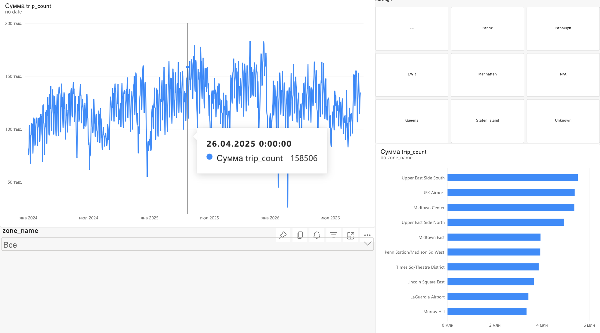
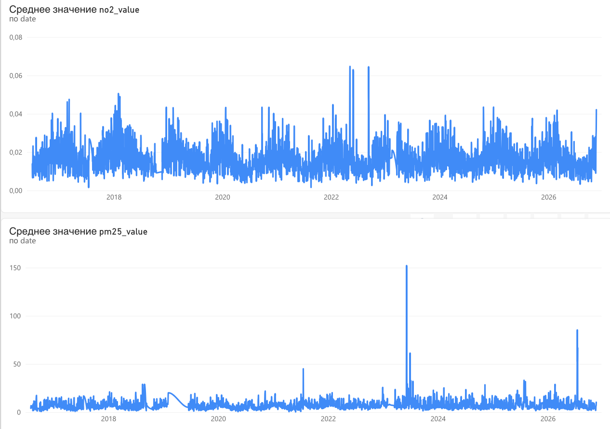
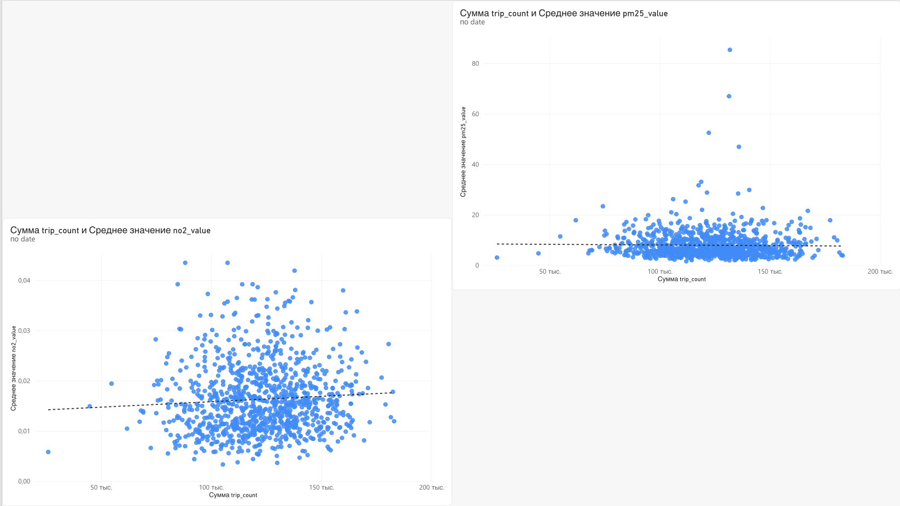
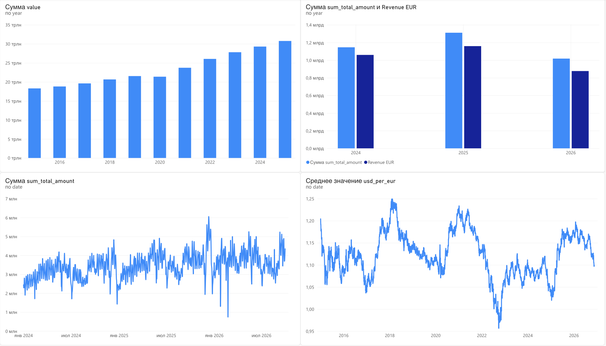

# NYC Mobility & Air Quality: Microsoft Fabric Data Engineering Project

An analytics platform on Microsoft Fabric that unifies NYC yellow taxi trips, OpenAQ air quality, World Bank GDP and ECB FX rates in a medallion architecture (Bronze → Silver → Gold) with a star-schema Warehouse and a Power BI report.

Final project of the Itransition "Intern Data Engineer" course.

## Architecture

```
Sources                    Bronze (lh_bronze)        Silver (lh_silver)       Gold (wh_gold)
-------                    ------------------        ------------------       --------------
NYC TLC (parquet, HTTP) -> Files/taxi/*.parquet  ->  taxi, taxi_rejected  ->  fact_taxi_daily
OpenAQ API (JSON)       -> Files/air/*.json      ->  air_quality,         ->  fact_air_quality_daily
                                                     zone_station_map
ECB FX (CSV API)        -> dbo.ecb_usd_eur       ->  fx                   ->  dim_fx
World Bank GDP (JSON)   -> dbo.worldbank_gdp     ->  gdp                  ->  dim_gdp
Zone lookup (CSV)       -> Files/zone/…          ->  (read directly)      ->  dim_zone, dim_date
```

Orchestration: one Fabric Data Pipeline (`pl_main`): four Bronze loads run in parallel, a barrier (`bronze_done`) waits for all of them, then Silver and Gold notebooks run in a chain, and a final Script activity builds `fact_taxi_daily` in the Warehouse.

## Data sources and ingestion tools

| Source                                                                  | Format                                       | Tool                                                       | Why                                                                                                            |
| ----------------------------------------------------------------------- | -------------------------------------------- | ---------------------------------------------------------- | -------------------------------------------------------------------------------------------------------------- |
| NYC TLC yellow taxi, 2024-01 → 2026-09 (33 monthly files, ~123.5M rows) | Parquet over HTTP                            | Pipeline Copy activity inside a ForEach (`pl_taxi_ingest`) | Large ready-made files, copied as-is (Binary) into Bronze                                                      |
| OpenAQ v3 daily measurements (PM2.5, NO2, 12 sensors, 2016 → today)     | Nested JSON, paginated REST API with API key | PySpark notebook (`nb_bronze_air`) + Azure Key Vault       | Nested JSON, pagination (max 1000 per page), retries; the key must never end up in code or in a Dataflow query |
| ECB USD/EUR daily rates                                                 | CSV API                                      | Dataflow Gen2 (`df_ecb_fx`)                                | Small open API with light transformation                                                                       |
| World Bank GDP (USA)                                                    | JSON API                                     | Dataflow Gen2 (`df_worldbank_gdp`)                         | Small open API with light transformation                                                                       |

Deviation from the project scope: the scope suggests Dataflow Gen2 for OpenAQ. I used a notebook instead because of the nested JSON, per-sensor pagination, retry logic, and because the API key is kept in Azure Key Vault (read with `notebookutils.credentials.getSecret`). Dataflow Gen2 is used for ECB and World Bank.

## Repository structure

```
fabric/notebooks/    PySpark notebooks (Bronze air, Silver, Gold dimensions and air fact)
fabric/sql/          fact_taxi_daily.sql (T-SQL CTAS run by the pipeline)
fabric/pipelines/    JSON definitions of pl_taxi_ingest and pl_main
fabric/dataflows/    Power Query (M) of df_ecb_fx and df_worldbank_gdp
docs/                data dictionary, lineage, governance, report screenshots
*.py, reference/     local prototypes used while developing (not part of the Fabric run)
```

## Data model (Gold, star schema)

- `fact_taxi_daily`: one row per pickup date and pickup zone (239,457 rows). Trips, fares, tips, distance, duration, plus quality counters (invalid duration, non-positive amount, outliers, disputed payments).
- `fact_air_quality_daily`: one row per date and zone (952,301 rows, 2016-07-01 → 2026-11-19). PM2.5 and NO2 as columns, each with station id, distance to the station and quality flags.
- `dim_date` (5,844 days, 2015 → 2030), `dim_zone` (265 TLC zones), `dim_fx` (USD per 1 EUR, one row per calendar day), `dim_gdp` (US GDP by year, 2015 → 2030; future years NULL).
  Zones are linked to air-quality stations by distance (computed locally with geopandas, loaded as `zone_station_map`): each zone has its own nearest PM2.5 and NO2 station.

## Data quality principles

- Keep and flag, never silently drop. Bad values get `is_*` flags; rows with a pickup date outside the file's month go to `taxi_rejected` with a reason.
- Control rule: Bronze = Silver + rejected (123,471,721 = 123,470,919 + 802).
- Outlier thresholds (0.999 quantile) are computed per month.
- Missing air-quality measurements stay NULL (and flagged), never replaced by zero.
- Full reruns are idempotent: file names contain the month, Silver and Gold are overwritten, Dataflows use Replace.

## Report (Power BI on a Direct Lake semantic model)

Semantic model `sm_taxi_air` on the Warehouse tables, report with four pages:

1. **Mobility**: trips per day with borough and zone slicers, top 10 pickup zones.
   
2. **Air Quality**: daily PM2.5 and NO2 (average across zones).
   
3. **Correlation**: trips per day vs PM2.5 and vs NO2 (one point per day, trend line).
   
4. **Economic impact**: taxi revenue in USD and EUR (DAX measure divides each day's revenue by that day's ECB rate), US GDP, USD/EUR rate.
   

## Findings

- Busiest pickup zones are in Midtown and the Upper East Side, plus JFK and LaGuardia airports.
- At city level there is no visible relationship between daily taxi trips and PM2.5, and only a weak positive one with NO2. This is not causal: trips are a proxy for overall city activity, and weather, wind and season dominate pollution.
- Converting revenue to EUR changes the picture: revenue grew about 14% in USD from 2024 to 2025 but only about 10% in EUR, because the euro strengthened.
- Notable events in the data: sharp drops in trips in early 2026 and PM2.5 spikes (mid-2023, mid-2026) were kept and flagged rather than removed.

## Known limitations

- Facts are daily, so time-of-day analysis (rush hour) is not covered.
- Taxi data covers 2024-01 → 2026-09; GDP and FX cover a wider range, 2026 is a partial year.
- Zones 264/265 and some boroughs (`N/A`, `Unknown`) are TLC placeholders without a real station.
- The list of months for the taxi pipeline is manual; reference files (`openaq_sensors.csv`, `zone_station_map.csv`, `taxi_zone_lookup.csv`) are updated by hand.
- The pipeline schedule (weekly, Sunday 03:00) is created but disabled, because scheduled runs require a running Fabric capacity.

## Security

The OpenAQ API key is stored in Azure Key Vault (RBAC) and read by the notebook at run time. No secrets are stored in code or in this repository; local development uses a git-ignored `.env`.

## How to run

1. Resume the Fabric capacity and open the workspace.
2. Run the pipeline `pl_main` (parameter `months` lists the taxi months to download).
3. Open the report `NYC Mobility & Air Quality` on the semantic model `sm_taxi_air`.
