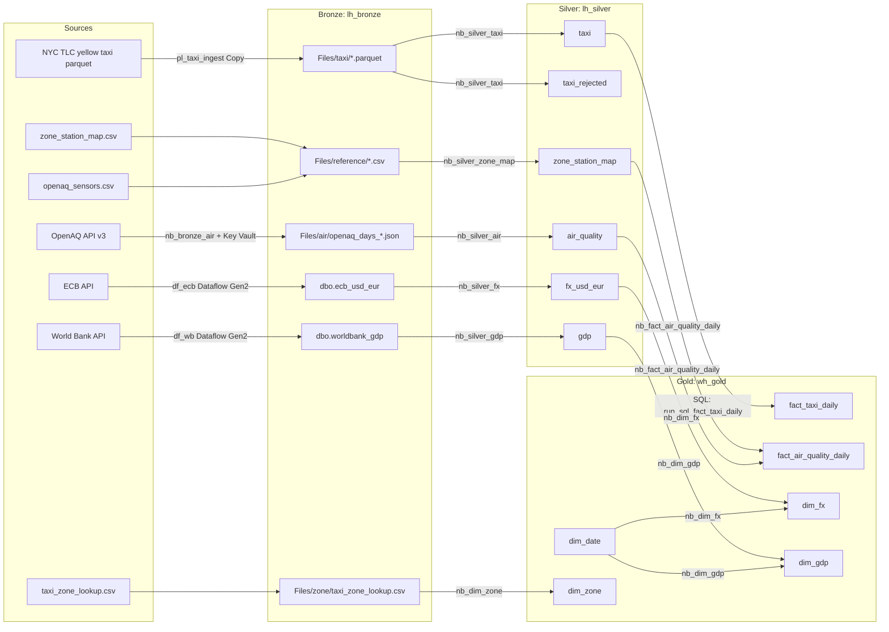

# Data lineage

End-to-end flow of the pipeline `pl_main`: Bronze (raw) → Silver (cleaned, typed, flagged) → Gold (star schema in `wh_gold`).
Each layer reads only the previous one. Nothing is silently deleted; rows are flagged or routed to `taxi_rejected`.

## Notes

- **Order in `pl_main`:** four Bronze loads in parallel → `bronze_done` barrier → Silver notebooks in a chain → Gold in a chain (`dim_date` first, because `dim_fx` and `dim_gdp` read it) → `fact_taxi_daily` (T-SQL).
- **Taxi ↔ air link:** not built in Gold. Both facts share `zone_id` (= `PULocationID`) and the date, joined through `dim_zone` and `dim_date` in the semantic model `sm_taxi_air`.
- **`zone_station_map`:** computed locally (geopandas: nearest station per zone and parameter), loaded as CSV. 263 zones × 2 parameters = 526 rows. Gives `zone_id`, `station_id`, distance and `is_far_station`.
- **Control rule:** Bronze taxi rows = Silver `taxi` + `taxi_rejected` (123,471,721 = 123,470,919 + 802).
- **Secrets:** the OpenAQ key lives in Azure Key Vault `kv-itra-fioda`, read at runtime by `nb_bronze_air`; it is not in code or in the repository.
- **Exception to the layer chain:** `dim_zone` is built directly from the Bronze file `Files/zone/taxi_zone_lookup.csv` (columns renamed to `zone_id`, `borough`, `zone_name`; `service_zone` kept). It is a small reference table that needs no cleaning, so there is no Silver step for it.
